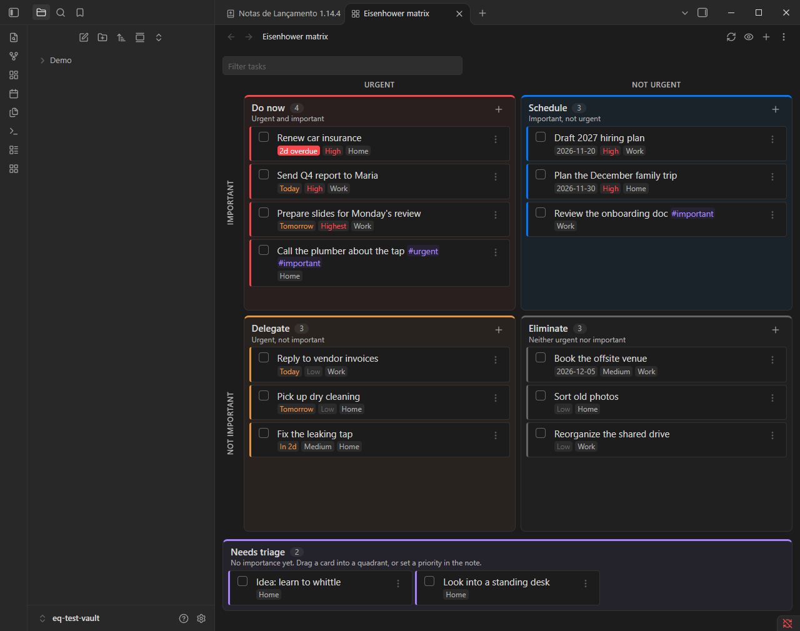

# Eisenhower Quadrants

An Eisenhower matrix (*matriz de Eisenhower*) for the checkbox tasks you already have in your notes. No new syntax, no separate task database: the plugin reads `- [ ]` lines from your vault and writes changes back to the same lines.



## The idea

The Eisenhower method sorts tasks on two questions, and they are not the same kind of question:

- **Urgent?** is mechanical. It depends on the calendar, so the plugin **computes it from the due date**. A task drifts from *Schedule* to *Do now* by itself as the deadline gets close, and you never move it by hand.
- **Important?** is a judgment. Only you know, so the plugin **does not guess it**. A task with no priority and no tag lands in a **Needs triage** tray instead of silently being filed under "eliminate".

| | Urgent | Not urgent |
| --- | --- | --- |
| **Important** | **Do now** | **Schedule** |
| **Not important** | **Delegate** | **Eliminate** |

## How a task is placed

1. **Pinned** wins. Dragging a card to a quadrant writes a tag such as `#eisenhower/schedule` on the task line.
2. **Urgent** when the due date is today, overdue, or within the next *N* days (default 2), or when the task has an urgent tag (`#urgent` or `#urgente` by default).
3. **Important** when the task has an important tag (`#important` or `#importante` by default) or a high or highest priority. Low and lowest priority are not important. Medium priority is not important unless you turn that on.
4. No importance signal at all means **Needs triage** (configurable: you can treat such tasks as important or not important instead).

Hover a card to see why it is where it is.

Dates and priorities use the same markers as the [Tasks](https://github.com/obsidian-tasks-group/obsidian-tasks) plugin, which is optional:

```markdown
- [ ] Send the report 📅 2026-10-30 ⏫
- [ ] Renew insurance [due:: 2026-11-05] 🔼
- [ ] Call the plumber #urgent #important
- [ ] Sort old photos 🔽
```

Priority markers: 🔺 highest, ⏫ high, 🔼 medium, 🔽 low, ⏬ lowest.

## Using it

- **Open matrix** (ribbon icon or command palette) shows every task in the vault. Filter by text, show or hide completed tasks, add a task with the plus button.
- **Drag** a card to another quadrant, or use the ⋮ menu (also on right click) to *Move to…*, *Open in note*, or *Return to automatic placement*. The menu is the way to move cards on touch screens.
- **Click the checkbox** to complete a task. It writes `[x]` and a `✅ date` like the Tasks plugin does; unchecking removes the date. Recurring tasks (`🔁`, `[repeat::]`) are completed in the note, so the next occurrence is scheduled properly.
- **Click the task text** to jump to its line in the note.
- **Add task** (command or plus button) appends a line to a note of your choice (`Eisenhower inbox.md` by default).

### Embed a matrix in a note

````markdown
```eisenhower
```
````

By default an embedded matrix shows the tasks of the note it sits in. Options:

````markdown
```eisenhower
folder: Projects/Website
tag: work
completed: true
```
````

| Option | Meaning |
| --- | --- |
| *(none)* | Tasks of the current note |
| `file: Some note` | Tasks of another note (a name or `[[link]]`) |
| `folder: Path/To/Folder` | Tasks in a folder and its subfolders |
| `tag: work` | Tasks with that tag on their line, or in notes with that tag in their frontmatter |
| `vault: true` | Every task in the vault |
| `completed: true` | Also show completed tasks |

`folder` and `tag` can be combined.

## Settings

Urgency window, urgent and important tags, medium priority, what to do with unrated tasks, the pin tag prefix, folders to include or ignore, completed tasks, done dates, and the note that receives new tasks.

## Install

The plugin is not in the community plugin list yet. Until it is:

**With BRAT**: install the BRAT plugin, choose *Add beta plugin*, and enter `lucasnad/eisenhower-quadrants`.

**Manually**: download `main.js`, `manifest.json` and `styles.css` from the [latest release](https://github.com/lucasnad/eisenhower-quadrants/releases/latest), put them in `<your vault>/.obsidian/plugins/eisenhower-quadrants/`, and enable the plugin under *Settings → Community plugins*.

Requires Obsidian 1.8.7 or later. The layout adapts to narrow panes and phones. Drag and drop uses desktop drag events, so on a touch screen use the ⋮ menu. I have not been able to test on a physical phone yet.

The plugin makes no network requests and collects nothing. It only edits the task lines you act on, never anything else in a note, and it refuses to edit a line that changed in the note since the matrix last read it.

## Português

Matriz de Eisenhower para as tarefas com checkbox que você já tem nas notas, sem sintaxe nova. A **urgência é calculada pela data de vencimento** (uma tarefa passa de *Agendar* para *Fazer agora* sozinha conforme o prazo chega) e a **importância é decisão sua**: tarefa sem prioridade nem tag vai para **Para triar**, em vez de ser jogada em "eliminar". Arrastar um cartão fixa a tarefa num quadrante gravando uma tag `#eisenhower/...` na linha. A interface segue o idioma do Obsidian (português do Brasil e inglês).

Datas e prioridades usam os mesmos marcadores do plugin Tasks (`📅 2026-10-30`, `⏫`). Para embutir a matriz numa nota, use um bloco de código `eisenhower` (opções acima). Instalação por BRAT: `lucasnad/eisenhower-quadrants`.

## Development

```bash
npm install
npm run dev      # watch build into main.js
npm test         # unit tests for the parsing and placement logic
npm run lint     # Obsidian's own ESLint rules
npm run build    # type check and production bundle
```

To try it, symlink or copy the folder to `<vault>/.obsidian/plugins/eisenhower-quadrants/` and reload the plugin. The task logic lives in `src/tasks.ts` and has no Obsidian dependency; everything that touches the vault is in `src/service.ts` and `src/controller.ts`.

To release: run `npm version patch` (it updates `manifest.json` and `versions.json` and creates the tag), `npm run build`, push with `git push --follow-tags`, then attach the build to a release whose tag equals the version, with no `v` prefix:

```bash
gh release create 1.0.1 main.js manifest.json styles.css --generate-notes
```

## License

[MIT](LICENSE)
